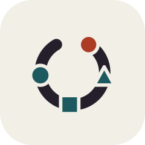
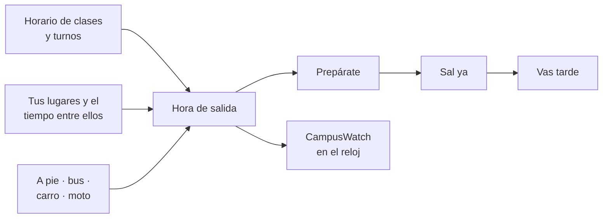
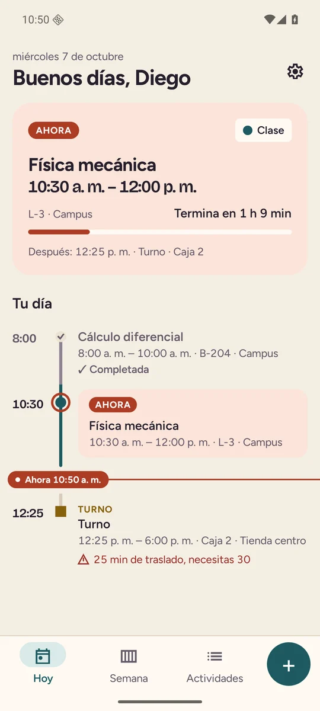
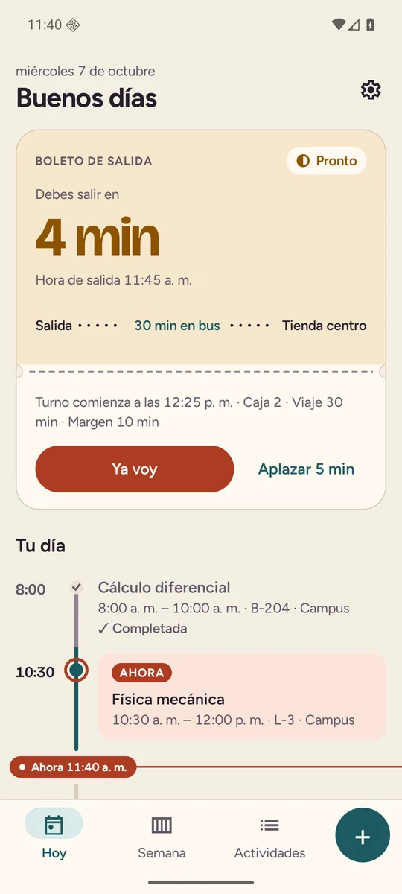
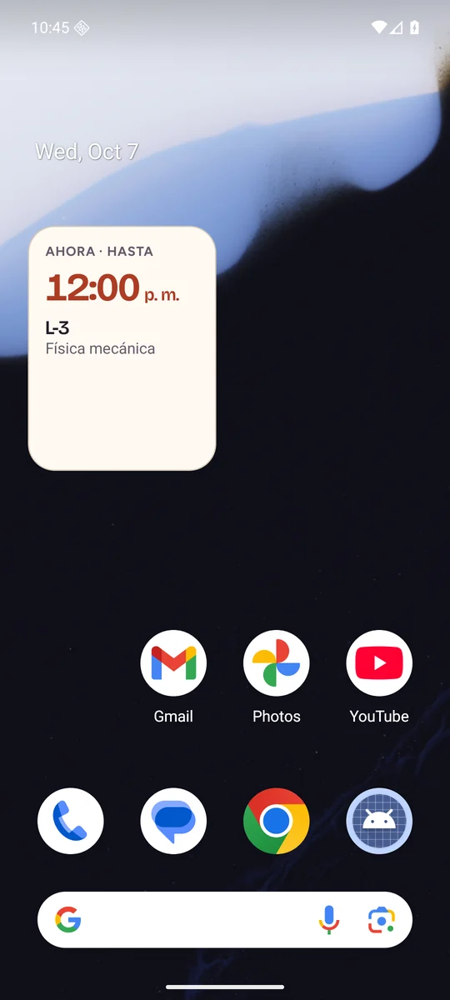
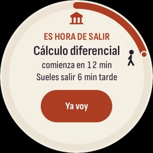
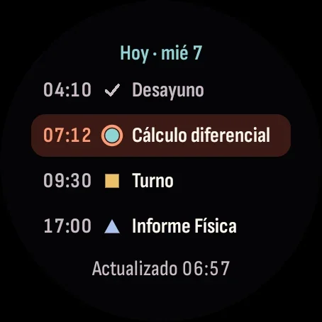
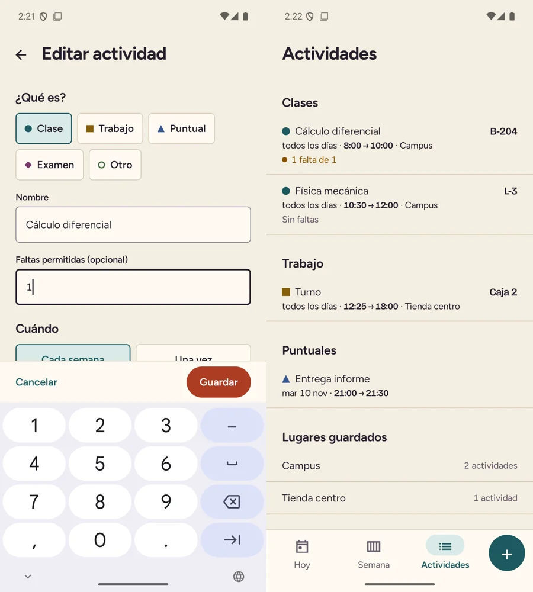

<div align="center">



# Agenda + CampusWatch

**Dónde tengo que estar y a qué hora tengo que salir.**

Horario de la universidad y del trabajo en un solo lugar, con el aviso de salida<br/>
en el teléfono y en la muñeca.


[Cómo probarla](#cómo-probarla) · [Cuentas de prueba](https://github.com/diarpicu2022-commits/mi-portafolio/blob/feat/portfolio-foundation/docs/Cuentas%20de%20prueba.md) · [Portafolio](https://mi-portafolio-beta-kohl.vercel.app)

</div>

---

## La idea

Cuando estudias y trabajas, el problema no es acordarte de la clase. Es salir a tiempo cuando la clase es en el campus y el turno en el otro lado de la ciudad. Agenda junta los dos horarios y calcula la hora de salida con el tiempo de traslado entre tus lugares y el modo en que te mueves.



## Capturas

<div align="center">

| Hoy | Boleto de salida | Widget | Reloj · es hora de salir | Reloj · horario |
|:---:|:---:|:---:|:---:|:---:|
|  |  |  |  |  |



</div>

## Qué hace

### El día responde solo

- **Hoy** dice qué sigue, cuándo salir y cómo va el día en una línea de tiempo con el «ahora» marcado.
- **El boleto de salida** cuenta los minutos que faltan para salir, con el trayecto y el modo («30 min en bus»), y deja aplazar 5 minutos.
- **Avisos por etapas**, primero «prepárate», luego «sal ya» y, si se pasó la hora, «vas tarde». Llegan al minuto aunque el teléfono esté en reposo.

### El horario como es de verdad

- Las clases se repiten por semana **solo entre las fechas del semestre** y se saltan los **festivos de Colombia**.
- **Cancelar una sola sesión** («hoy no hay Cálculo») sin tocar la serie.
- **Conflictos**, cuando dos actividades se cruzan o cuando no alcanzas a llegar de una a otra.
- Clases, turnos, exámenes y entregas, cada uno con su lugar.

### Las cuentas que uno lleva

- **Asistencia** con el límite de faltas por materia.
- **Horas trabajadas** a partir de los turnos.
- **Resumen** del día y centro de avisos.

### CampusWatch, en la muñeca

- La próxima actividad con su **anillo de cuenta regresiva** y el aviso **«Es hora de salir»**.
- El horario de hoy y mañana, la asistencia, una tarjeta y una complicación para la esfera.
- Funciona con el último día que le mandó el teléfono, así que **sirve sin conexión**.
- **Modo demostración** para verlo sin teléfono emparejado.

### Cómoda de usar

- Modo claro y oscuro, a elección o como el sistema.
- Español e inglés, con fechas y horas en el formato de cada idioma.
- Widget de inicio con la actividad de ahora.

## Cómo probarla

Agenda **no necesita cuenta**. Todo se guarda en el teléfono, cifrado.

1. Instala el APK del teléfono y, si tienes un reloj Wear OS, el del reloj. Los dos tienen que ser de la misma versión para hablar entre sí.
2. Crea el semestre, dos lugares con el tiempo de traslado entre ellos y unas clases.
3. Mira cómo aparece la hora de salida en Hoy y espera los avisos.
4. Crea dos actividades que se crucen para ver el aviso de conflicto.

**Demostración en el reloj.** Sin teléfono emparejado, entra a «Sin horario» y toca **«Ver demostración»**. Carga un día de ejemplo relativo a la hora actual (una clase en 18 minutos, un turno con bus y una entrega) y marca «Demostración» en el pie. Se sale desde la misma página y nunca se mezcla con datos reales.

> Los APK se entregan aparte mientras se define el canal de publicación (Google Play o GitHub Releases).

## Compilar desde el código

**Requisitos:** JDK 21 (con JDK 25 no compila) y el SDK de Android por línea de comandos o Android Studio.

```bash
git clone https://github.com/diarpicu2022-commits/agenda-android.git
cd agenda-android
echo "sdk.dir=/ruta/al/android-sdk" > local.properties   # no se sube a git

./gradlew assembleDebug                       # teléfono y reloj
./gradlew testDebugUnitTest :core:domain:test # pruebas
./gradlew lintDebug
./gradlew :app:installDebug :wear:installDebug
```

### APK de release firmado

1. Crea una llave fuera del repo con `keytool -genkeypair` y guarda su contraseña en un lugar seguro.
2. Crea `key.properties` en la raíz (está en `.gitignore`) con `storeFile`, `storePassword`, `keyAlias` y `keyPassword`.
3. Compila con `./gradlew assembleRelease`.

Sin `key.properties`, el release se firma con la llave de depuración, la misma para el teléfono y el reloj.

## Stack

| Capa | Tecnología |
|---|---|
| Interfaz | Kotlin 2.4, Jetpack Compose con Material 3 como base y tema propio |
| Arquitectura | Una sola Activity, MVVM con `UiState` inmutable, capas `ui / domain / data`, Hilt |
| Datos | Room sobre SQLCipher. La clave es aleatoria y va envuelta con el Android Keystore |
| Preferencias | DataStore |
| Avisos | `AlarmManager` exacto y WorkManager, reprogramados al reiniciar o cambiar la hora |
| Tiempo | `java.time`, con las series guardadas como hora local, día y zona |
| Reloj | Compose para Wear OS, Tiles, complicaciones y la capa de datos de Wear OS |

```
agenda-android
├── app/                 la app del teléfono
├── wear/                CampusWatch, la app del reloj
├── core/
│   └── domain/          la lógica sin Android, con pruebas
│                        (ScheduleExpander, ConflictDetector,
│                         DepartureCalculator, festivos de Colombia)
├── docs/
│   ├── arquitectura.md  alcance y decisiones técnicas
│   ├── ux/              anexos de diseño
│   ├── capturas/        evidencia de cada paso
│   └── legal/           política de privacidad
└── tools/               verificación y generación del ícono
```

El reloj usa el mismo `applicationId` que el teléfono porque la capa de datos de Wear OS solo une apps con el mismo paquete y la misma firma.

## Cómo lo diseñamos

Agenda tiene su propio sistema de diseño, con Archivo para las cifras y Atkinson Hyperlegible para el texto, porque se lee caminando y con prisa. La pieza principal es la **banda de salida**, que tiene siete estados (espera, prepárate, sal ya, vas tarde, en camino, sin traslado y dato viejo) y se diseñó antes que cualquier pantalla. Cada paso pasó por investigación, propuestas, una elegida y verificación medida en el emulador y en un teléfono real. Los anexos están en `docs/ux/` y las capturas de cada paso en `docs/capturas/`.

## Datos personales

- No hay cuenta, ni servidor, ni rastreo.
- La app no pide permiso de internet ni de ubicación. Solo pide notificaciones, alarmas exactas y arrancar al encender el teléfono, para que los avisos lleguen al minuto.
- El horario, los lugares y la asistencia se guardan cifrados en el teléfono.

La política está en `docs/legal/politica-privacidad.md`. Es un borrador técnico que debe revisar un abogado antes de publicar en Google Play.

## Hoja de ruta

- Probar la demostración en un reloj real con la versión release.
- No molestar automático durante las clases.
- Importar y exportar el horario en `.ics`.
- Notas rápidas por clase.
- Definir el canal de actualizaciones (Google Play o GitHub Releases).

---

<div align="center">

Proyecto final de **Diseño de Interfaces de Software** · 5.º semestre · Universidad Cooperativa de Colombia

Hecho por **Diego Armando Pinta Cuasquen** · [GitHub](https://github.com/diarpicu2022-commits) · [Portafolio](https://mi-portafolio-beta-kohl.vercel.app)

</div>
